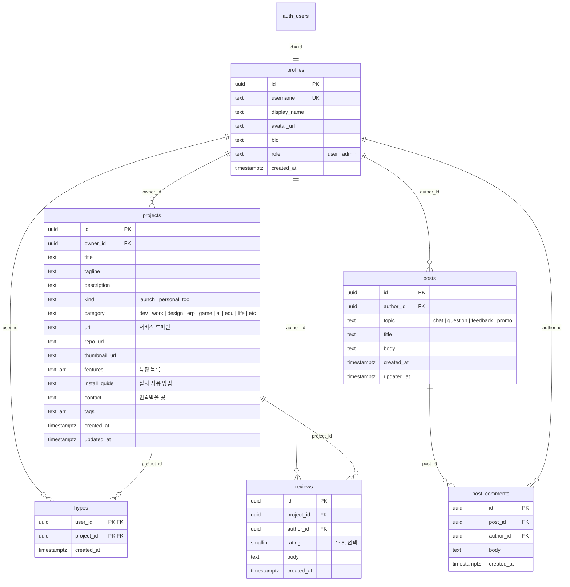

# showcase · build for me — 데이터베이스 & 기능 설계

개인이 만든 웹·앱(이하 **프로젝트**)을 등록·홍보하고, 커뮤니티에서 자유롭게 이야기하는 사이트의 DB 구조와 기능 명세.

- DB: Supabase (PostgreSQL) · 인증: Supabase Auth
- 마이그레이션: `supabase/migrations/0001` → `0004` 순서로 실행

---

## 1. 설계 원칙

| 원칙 | 내용 |
|---|---|
| 서버 전용 접근 | 모든 DB 읽기/쓰기는 Next.js 서버에서 **secret key** 로만 한다. 브라우저는 DB 에 직접 접근하지 않는다. |
| 권한은 서버 코드에서 | "본인만 수정/삭제", "관리자는 전부" 같은 규칙은 서버 액션에서 검사한다 (`getViewer()`). |
| RLS 잠금 | 모든 테이블에 RLS 를 켜고 정책을 만들지 않는다 → publishable key 로는 아무것도 못 읽는다(방어용 이중 잠금). |
| 사용자 = Auth 유저 | `profiles.id` 는 `auth.users.id` 와 같은 값. 첫 로그인 때 서버가 프로필 행을 만든다(`ensureProfile`). |
| 집계는 count | Hype·댓글 수는 카운터 컬럼 없이 `count(*)` 로 센다(동기화 버그 없음). |

---

## 2. ER 다이어그램

모든 FK 는 `on delete cascade` — 회원이 지워지면 그 회원의 프로젝트·Hype·후기·글·댓글도 지워지고, 프로젝트/글이 지워지면 딸린 Hype·후기·댓글도 지워진다.

---

## 3. 테이블 명세

### 3.1 `profiles` — 회원

| 컬럼 | 타입 | 제약 | 설명 |
|---|---|---|---|
| id | uuid | PK | Supabase Auth 사용자 id |
| username | text | not null, unique | URL 용 아이디 (`/u/{username}`). 영문 소문자·숫자·`-_` |
| display_name | text | | 표시 이름 (소셜 프로필 이름) |
| avatar_url | text | | 프로필 사진 |
| bio | text | | 소개 |
| role | text | `user`/`admin`, 기본 `user` | 관리자 여부 |
| created_at | timestamptz | 기본 now() | 가입일 |

### 3.2 `projects` — 프로젝트(상품)

| 컬럼 | 타입 | 제약 | 설명 |
|---|---|---|---|
| id | uuid | PK | |
| owner_id | uuid | FK → profiles | 등록자 |
| title | text | not null, 1~100자 | 프로젝트명 |
| tagline | text | ≤150자 | 한 줄 소개 (카드에 표시) |
| description | text | ≤5000자 | 자세한 설명 |
| kind | text | `launch`/`personal_tool` | 출시 서비스 / 개인용 도구 |
| category | text | 9종 check | 개발·업무·디자인·ERP·게임·AI·교육·생활·기타 |
| url | text | http(s) 만 | **서비스 도메인** (써보기 버튼) |
| repo_url | text | http(s) 만 | GitHub 저장소 |
| thumbnail_url | text | http(s) 만 | **썸네일** (16:10 권장) |
| features | text[] | 최대 10개 · 각 100자 | **특징** (상세에 체크리스트) |
| install_guide | text | ≤5000자 | **설치·사용 방법** (상세에 코드 블록) |
| contact | text | ≤200자 | **연락받을 곳** (이메일이면 mailto, 링크면 새 창) |
| tags | text[] | 최대 5개 | 태그 |
| created_at / updated_at | timestamptz | | 수정 시 서버가 updated_at 갱신 |

인덱스: `owner_id`, `created_at desc`, `(category, created_at desc)`

### 3.3 `hypes` — 응원(좋아요)

PK `(user_id, project_id)` → 한 사람이 한 프로젝트에 한 번만. 다시 누르면 삭제(토글).

### 3.4 `reviews` — 프로젝트 후기

`rating` 1~5 (선택), `body` 필수 ≤2000자. 로그인 사용자만 작성.

### 3.5 `posts` — 커뮤니티 게시글

| 컬럼 | 타입 | 제약 | 설명 |
|---|---|---|---|
| id | uuid | PK | |
| author_id | uuid | FK → profiles | 작성자 |
| topic | text | `chat`/`question`/`feedback`/`promo` | 말머리: 잡담·질문·피드백 요청·홍보 |
| title | text | not null, ≤100자 | |
| body | text | not null, ≤10000자 | |
| created_at / updated_at | timestamptz | | |

인덱스: `created_at desc`, `(topic, created_at desc)`

### 3.6 `post_comments` — 게시글 댓글

`body` 필수 ≤2000자. 인덱스 `(post_id, created_at)`.

---

## 4. 권한 매트릭스

| 동작 | 비회원 | 회원 | 작성자 본인 | 관리자 |
|---|:-:|:-:|:-:|:-:|
| 프로젝트·글·후기 보기, 검색 | ✓ | ✓ | ✓ | ✓ |
| 프로젝트 등록 | | ✓ | | ✓ |
| 프로젝트 수정·삭제 | | | ✓ | ✓ (전체) |
| Hype 누르기 / 후기 쓰기 | | ✓ | | ✓ |
| 게시글·댓글 쓰기 | | ✓ | | ✓ |
| 게시글·댓글 삭제 | | | ✓ | ✓ (전체) |
| 관리자 페이지, 회원 권한 변경 | | | | ✓ (자기 자신 해제 불가) |

구현: 쿼리에 `.eq("owner_id", viewer.id)` 조건을 붙이고, 관리자면 조건을 뺀다. 화면의 버튼 숨김은 편의일 뿐이고 실제 차단은 서버 액션에서 한다.

---

## 5. 기능 명세

### 5.1 회원가입 · 로그인
- **소셜**: 카카오 · Google · GitHub (`signInWithOAuth`). 처음 로그인하면 자동 가입.
- **이메일**: 이메일 + 비밀번호 + **비밀번호 확인**.
  - 입력 중 일치 여부를 바로 표시하고, 8자 미만이거나 불일치면 가입 버튼이 비활성화된다.
  - 서버에서도 형식·길이·일치를 다시 검사한다.
  - 가입 후 확인 메일의 링크를 눌러야 완료 (`/auth/callback`).
- 모든 경로는 `/auth/callback` 또는 로그인 액션에서 `ensureProfile()` 로 프로필을 만든다. username 은 소셜 아이디 → 이메일 앞부분 순, 중복이면 `-{id 6자리}` 를 붙인다.

### 5.2 프로젝트(상품) 등록 · 수정 · 삭제
등록 폼은 홍보 순서대로 4단계:
1. 기본 정보 — 프로젝트명*, 한 줄 소개, 카테고리, 종류, 썸네일
2. 도메인 · 링크 — 서비스 도메인, GitHub
3. 홍보 내용 — 특징(한 줄에 하나), 자세한 설명, 설치·사용 방법, 태그
4. 연락받을 곳 — 이메일·오픈채팅·SNS

상세 페이지: 썸네일 → 제목·소개 → Hype/써보기/GitHub → 설명 → **특징 체크리스트** → **설치 방법 코드 블록** → **연락처** → 후기.

### 5.3 커뮤니티 자유게시판
- 목록 `/community`: 말머리 필터, 제목·본문 미리보기·작성자·시간·댓글 수. 최신 50개.
- 글쓰기 `/community/new`: 말머리 선택 + 제목 + 내용. 로그인 필요(스팸 방지).
- 상세 `/community/{id}`: 본문 + 댓글. 본인/관리자 삭제.

### 5.4 관리자 `/admin`
- 프로젝트 · 게시글 · 회원 수 요약 탭
- 프로젝트: 보기 / 수정 / 삭제 · 게시글: 보기 / 삭제
- 회원: 관리자 지정 / 해제

### 5.5 홈 탐색
- 카테고리 스티키 사이드바 + 종류 탭 + 헤더 검색(제목·한 줄 소개)
- DB 에 프로젝트가 없으면 예시 카드 9개를 보여준다 (초기 오픈용, "예시" 표시)

---

## 6. 설정 체크리스트

1. Supabase SQL Editor 에서 `0001` → `0002` → `0003` → `0004` 실행
2. 첫 관리자 지정: `update profiles set role = 'admin' where username = '<내 아이디>';` (먼저 한 번 로그인해야 행이 생긴다)
3. Authentication → Providers: Kakao · Google · GitHub 켜고 각 개발자 콘솔의 Client ID/Secret 입력
4. Authentication → URL Configuration: Site URL 과 Redirect URLs 에 `https://<도메인>/auth/callback`, `http://localhost:3000/auth/callback`
5. Vercel 환경변수: `SUPABASE_URL`, `SUPABASE_PUBLISHABLE_KEY`, `SUPABASE_SECRET_KEY`

## 7. 다음 단계 후보
- 썸네일 직접 업로드 (Supabase Storage 버킷 `thumbnails`)
- 게시글 수정, 페이지네이션, 게시판 검색
- 신고 기능 (`reports` 테이블: target_type, target_id, reporter_id, reason)
