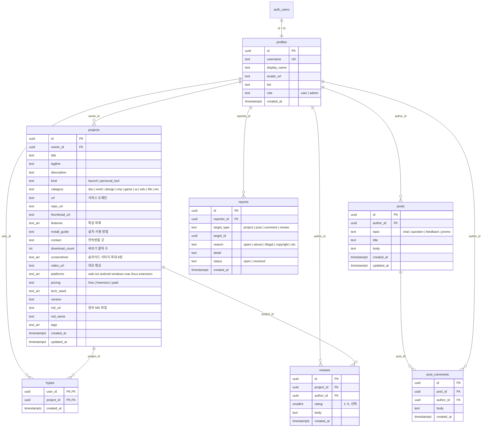

# showcase · build for me — 데이터베이스 & 기능 설계

개인이 만든 웹·앱(이하 **프로젝트**)을 등록·홍보하고, 커뮤니티에서 자유롭게 이야기하는 사이트의 DB 구조와 기능 명세.

- DB: Supabase (PostgreSQL) · 인증: Supabase Auth
- 마이그레이션: `supabase/migrations/0001` → `0007` 순서로 실행 (또는 합본 `supabase/setup.sql` 을 한 번에)
- 파일 저장: Supabase Storage `thumbnails`(이미지) · `files`(MD 첨부) 버킷 (공개 읽기)

---

## 1. 설계 원칙

| 원칙 | 내용 |
|---|---|
| 서버 전용 접근 | 모든 DB 읽기/쓰기는 Next.js 서버에서 **secret key** 로만 한다. 브라우저는 DB 에 직접 접근하지 않는다. |
| 권한은 서버 코드에서 | "본인만 수정/삭제", "관리자는 전부" 같은 규칙은 서버 액션에서 검사한다 (`getViewer()`). |
| RLS 미사용 | RLS 는 쓰지 않는다. DB 는 서버(secret key)에서만 접근하므로 권한은 서버 코드 한 곳에서 관리한다. **publishable key 로 브라우저에서 DB 를 직접 부르는 코드를 만들지 않는다.** |
| 사용자 = Auth 유저 | `profiles.id` 는 `auth.users.id` 와 같은 값. 첫 로그인 때 서버가 프로필 행을 만든다(`ensureProfile`). |
| 집계는 count | Hype·댓글 수는 카운터 컬럼 없이 `count(*)` 로 센다(동기화 버그 없음). |

---

## 2. ER 다이어그램

`reports.target_id` 는 여러 테이블을 가리키므로 FK 를 걸지 않는다(대상이 지워져도 신고 기록은 남는다).

모든 FK 는 `on delete cascade` — 회원이 지워지면 그 회원의 프로젝트·Hype·후기·글·댓글도 지워지고, 프로젝트/글이 지워지면 딸린 Hype·후기·댓글도 지워진다.

---

## 3. 테이블 명세

### 3.1 `profiles` — 회원

| 컬럼 | 타입 | 제약 | 설명 |
|---|---|---|---|
| id | uuid | PK | Supabase Auth 사용자 id |
| username | text | not null, unique | URL 용 아이디 (`/u/{username}`). 영문 소문자·숫자·`-_` |
| display_name | text | | 표시 이름 (소셜 프로필 이름) |
| avatar_url | text | | 프로필 사진 |
| bio | text | | 소개 |
| role | text | `user`/`admin`, 기본 `user` | 관리자 여부 |
| created_at | timestamptz | 기본 now() | 가입일 |

### 3.2 `projects` — 프로젝트(상품)

| 컬럼 | 타입 | 제약 | 설명 |
|---|---|---|---|
| id | uuid | PK | |
| owner_id | uuid | FK → profiles | 등록자 |
| title | text | not null, 1~100자 | 프로젝트명 |
| tagline | text | ≤150자 | 한 줄 소개 (카드에 표시) |
| description | text | ≤5000자 | 자세한 설명 |
| kind | text | `launch`/`personal_tool` | 출시 서비스 / 개인용 도구 |
| category | text | 9종 check | 개발·업무·디자인·ERP·게임·AI·교육·생활·기타 |
| url | text | http(s) 만 | **서비스 도메인** (써보기 버튼) |
| repo_url | text | http(s) 만 | GitHub 저장소 |
| thumbnail_url | text | http(s) 만 | **썸네일** (16:10 권장) |
| features | text[] | 최대 10개 · 각 100자 | **특징** (상세에 체크리스트) |
| install_guide | text | ≤5000자 | **설치·사용 방법** (상세에 코드 블록) |
| contact | text | ≤200자 | **연락받을 곳** (이메일이면 mailto, 링크면 새 창) |
| screenshots | text[] | 최대 8장 | **슬라이드 이미지** (상세 상단 슬라이드: 썸네일 → 스크린샷 순). 브라우저 → Storage 직접 업로드(서명 URL) |
| video_url | text | http(s) 만 | **데모 영상** (YouTube 면 상세에서 임베드 재생) |
| platforms | text[] | 7종 중 선택 | 웹·iOS·Android·Windows·macOS·Linux·브라우저 확장 |
| pricing | text | free/freemium/paid | 무료·부분 유료·유료 |
| tech_stack | text[] | 최대 10개 | 기술 스택 |
| version | text | ≤30자 | 버전 |
| md_url / md_name | text | .md, 1MB | **첨부 MD 파일** (프롬프트·가이드·README). 상세에서 미리보기 + 다운로드 + 한 번에 복사 |
| download_count | integer | 기본 0 | **다운로드 수** = 써보기 클릭 수 (`/go/{id}`, 같은 브라우저 하루 1회) |
| tags | text[] | 최대 5개 | 태그 |
| created_at / updated_at | timestamptz | | 수정 시 서버가 updated_at 갱신 |

인덱스: `owner_id`, `created_at desc`, `(category, created_at desc)`

### 3.3 `hypes` — 응원(좋아요)

PK `(user_id, project_id)` → 한 사람이 한 프로젝트에 한 번만. 다시 누르면 삭제(토글).

### 3.4 `reviews` — 프로젝트 후기

`rating` 1~5 (선택), `body` 필수 ≤2000자. 로그인 사용자만 작성.

### 3.5 `posts` — 커뮤니티 게시글

| 컬럼 | 타입 | 제약 | 설명 |
|---|---|---|---|
| id | uuid | PK | |
| author_id | uuid | FK → profiles | 작성자 |
| topic | text | `chat`/`question`/`feedback`/`promo` | 말머리: 잡담·질문·피드백 요청·홍보 |
| title | text | not null, ≤100자 | |
| body | text | not null, ≤10000자 | |
| created_at / updated_at | timestamptz | | |

인덱스: `created_at desc`, `(topic, created_at desc)`

### 3.6 `post_comments` — 게시글 댓글

`body` 필수 ≤2000자. 인덱스 `(post_id, created_at)`.

### 3.7 `reports` — 신고

| 컬럼 | 타입 | 제약 | 설명 |
|---|---|---|---|
| reporter_id | uuid | FK → profiles | 신고자 |
| target_type | text | project/post/comment/review | 신고 대상 종류 |
| target_id | uuid | | 대상 id |
| reason | text | spam/abuse/illegal/copyright/etc | 스팸·욕설·불법·저작권·기타 |
| detail | text | ≤500자 | 자세한 내용(선택) |
| status | text | open/resolved | 처리 상태 |

`unique (reporter_id, target_type, target_id)` — 같은 대상을 한 사람이 중복 신고 불가. 인덱스 `(status, created_at desc)`.

### 3.8 뷰 `project_feed` — 정렬용 피드

`projects` + 작성자 username + `hype_count` + `review_count` + `popularity`.
**인기 점수 = Hype × 3 + 후기 × 2 + 다운로드**. 홈의 정렬(인기순·다운로드순·Hype순·최신순)과 페이지 넘기기는 이 뷰를 쓴다.

### 3.9 함수 `increment_download(pid)`

`download_count + 1` 을 한 문장으로 처리(동시 클릭에도 숫자가 빠지지 않음).

### 3.10 Storage 버킷 `thumbnails`

공개 읽기, 3MB, PNG·JPG·WEBP·GIF. 경로 `{user_id}/{uuid}.{ext}`. 업로드는 서버(secret key)만 한다.

---

## 4. 권한 매트릭스

| 동작 | 비회원 | 회원 | 작성자 본인 | 관리자 |
|---|:-:|:-:|:-:|:-:|
| 프로젝트·글·후기 보기, 검색 | ✓ | ✓ | ✓ | ✓ |
| 프로젝트 등록 | | ✓ | | ✓ |
| 프로젝트 수정·삭제 | | | ✓ | ✓ (전체) |
| Hype 누르기 / 후기 쓰기 | | ✓ | | ✓ |
| 게시글·댓글 쓰기 | | ✓ | | ✓ |
| 게시글 수정 · 게시글·댓글 삭제 | | | ✓ | ✓ (전체) |
| 신고하기 | | ✓ | | ✓ |
| 신고 처리 (완료 / 대상 삭제) | | | | ✓ |
| 프로필 편집 | | | ✓ (본인) | |
| 관리자 페이지, 회원 권한 변경 | | | | ✓ (자기 자신 해제 불가) |

구현: 쿼리에 `.eq("owner_id", viewer.id)` 조건을 붙이고, 관리자면 조건을 뺀다. 화면의 버튼 숨김은 편의일 뿐이고 실제 차단은 서버 액션에서 한다.

---

## 5. 기능 명세

### 5.1 회원가입 · 로그인
- **소셜**: 카카오 · Google · GitHub (`signInWithOAuth`). 처음 로그인하면 자동 가입.
- **이메일**: 이메일 + 비밀번호 + **비밀번호 확인**.
  - 입력 중 일치 여부를 바로 표시하고, 8자 미만이거나 불일치면 가입 버튼이 비활성화된다.
  - 서버에서도 형식·길이·일치를 다시 검사한다.
  - 가입 후 확인 메일의 링크를 눌러야 완료 (`/auth/callback`).
- 모든 경로는 `/auth/callback` 또는 로그인 액션에서 `ensureProfile()` 로 프로필을 만든다. username 은 소셜 아이디 → 이메일 앞부분 순, 중복이면 `-{id 6자리}` 를 붙인다.

### 5.2 프로젝트(상품) 등록 · 수정 · 삭제
등록 폼은 홍보 순서대로 5단계 (기본 정보에 슬라이드 이미지·데모 영상, 4단계 "상세 정보"에 플랫폼·가격·기술 스택·버전):
1. 기본 정보 — 프로젝트명*, 한 줄 소개, 카테고리, 종류, 썸네일(파일 업로드 + 미리보기, 또는 이미지 주소)
2. 도메인 · 링크 — 서비스 도메인, GitHub
3. 홍보 내용 — 특징(한 줄에 하나), 자세한 설명, 설치·사용 방법, 태그
4. 연락받을 곳 — 이메일·오픈채팅·SNS

상세 페이지: **이미지 슬라이드** → 제목·한 줄 소개 → 가격·플랫폼·버전·업데이트일 → Hype/써보기/GitHub → **특징** → 소개 → **데모 영상** → **기술 스택** → **MD 파일** → **설치 방법** → 태그 → **연락처** → 후기.

삭제는 확인창을 한 번 거친다. 다른 사람 프로젝트에는 "신고" 버튼이 보인다.

### 5.3 커뮤니티 자유게시판
- 목록 `/community`: 말머리 필터 + 검색(제목·본문) + 페이지 넘기기(20개씩). 제목·본문 미리보기·작성자·시간·댓글 수.
- 글쓰기 `/community/new`, 수정 `/community/{id}/edit`: 말머리 + 제목 + 내용. 로그인 필요(스팸 방지).
- 상세 `/community/{id}`: 본문 + 댓글. 본인/관리자 수정·삭제, 다른 사람 글은 신고.

### 5.4 관리자 `/admin`
- 프로젝트 · 게시글 · 회원 · 처리할 신고 수 요약 탭
- 신고: 대상 보기 / 처리 완료 / 대상 삭제(같은 대상 신고 일괄 완료)
- 프로젝트: 보기 / 수정 / 삭제 · 게시글: 보기 / 삭제
- 회원: 관리자 지정 / 해제

### 5.5 홈 탐색
- 왼쪽: 카테고리 스티키 사이드바 · 카드 위: 가로 정렬 바(인기순 / 다운로드순 / Hype순 / 최신순) + 종류 탭
- 헤더 검색(제목·한 줄 소개), 27개씩 페이지 넘기기
- DB 에 프로젝트가 없으면 예시 카드 9개를 보여준다 (초기 오픈용, "예시" 표시)

---

## 6. 설정 체크리스트

1. Supabase SQL Editor 에 `supabase/setup.sql`(0001~0007 합본) 전체를 붙여넣고 Run
2. 첫 관리자 지정: `update profiles set role = 'admin' where username = '<내 아이디>';` (먼저 한 번 로그인해야 행이 생긴다)
3. Authentication → Providers: Kakao · Google · GitHub 켜고 각 개발자 콘솔의 Client ID/Secret 입력
4. Authentication → URL Configuration: Site URL 과 Redirect URLs 에 `https://<도메인>/auth/callback`, `http://localhost:3000/auth/callback`
5. Vercel 환경변수: `SUPABASE_URL`, `SUPABASE_PUBLISHABLE_KEY`, `SUPABASE_SECRET_KEY`

### 5.6 프로필
- `/u/{username}`: 소개 + 올린 프로젝트. 본인이면 "프로필 편집"
- `/settings`: 아이디(영문 소문자·숫자·-_ 3~30자, 중복 불가), 표시 이름, 소개

## 7. 다음 단계 후보
- 댓글·후기에도 신고 버튼 노출 (DB·관리자 처리는 이미 지원)
- 프로필 사진 업로드
- 알림 (내 프로젝트에 후기·Hype가 달리면)
